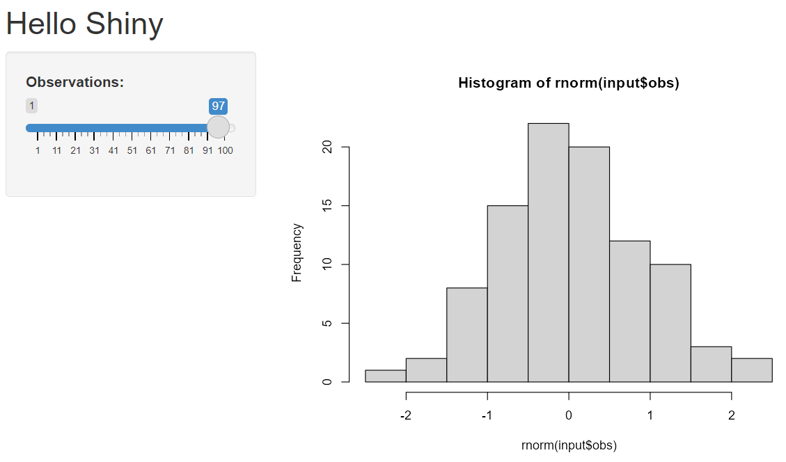
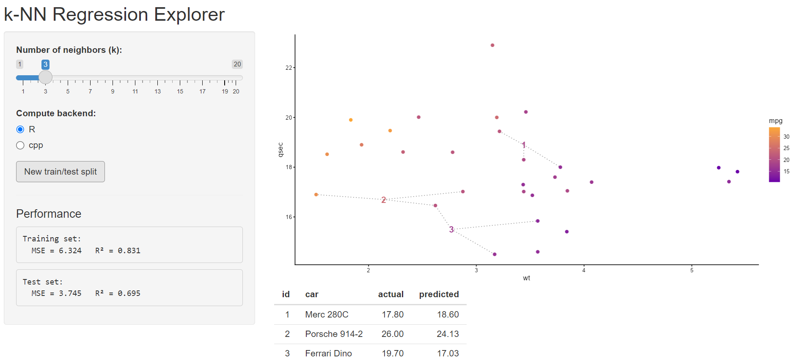
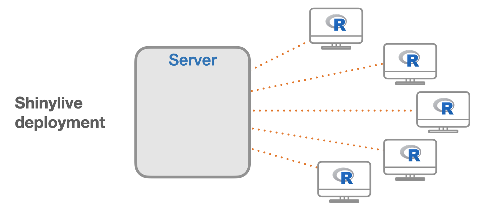

#  {visibility="hidden"}

\def\bx{\mathbf{x}}
\def\by{\mathbf{y}}
\def\bz{\mathbf{z}}
\def\bu{\mathbf{u}}
\def\bv{\mathbf{v}}
\def\bw{\mathbf{w}}
\def\bX{\mathbf{X}}
\def\bY{\mathbf{Y}}
\def\bZ{\mathbf{Z}}
\def\bU{\mathbf{U}}
\def\bV{\mathbf{V}}
\def\bW{\mathbf{W}}
\def\bI{\mathbf{I}}
\def\bH{\mathbf{H}}
\def\bS{\mathbf{S}}
\def\bD{\mathbf{D}}
\def\bbeta{\boldsymbol \beta}
\def\btheta{\boldsymbol \theta}
\def\bmu{\boldsymbol \mu}
\def\bSigma{\boldsymbol \Sigma}
\def\bLambda{\boldsymbol \Lambda}
\def\beps{\boldsymbol \epsilon}
\def\T{\text{T}}
\def\E{\mathrm{E}}
\def\var{\mathrm{Var}}
\def\cov{\mathrm{Cov}}
\def\cor{\mathrm{Corr}}
\def\se{\mathrm{se}}
\def\bias{\mathrm{bias}}
\def\mse{\mathrm{MSE}}
\def\R{\mathbb{R}}
\def\P{\mathrm{P}}
\def\iid{\stackrel{\text{iid}}{\sim}}
\DeclareMathOperator*{\argmin}{arg\,min}
\DeclareMathOperator*{\argmax}{arg\,max}

```{r}
#| label: setup
#| include: false
#| eval: true
library(knitr)
library(ggplot2)
library(patchwork)
knitr::opts_chunk$set(
    fig.asp = 0.618,
    fig.align = "center",
    out.width = "100%",
    fig.retina = 3,
    fig.path = "./images/10-shiny/",
    message = FALSE,
    warning = FALSE,
    global.par = TRUE
)
options(
  htmltools.dir.version = FALSE,
  dplyr.print_min = 6, 
  dplyr.print_max = 6,
  tibble.width = 80,
  width = 80,
  digits = 4
  )
hook_output <- knitr::knit_hooks$get("output")
knitr::knit_hooks$set(output = function(x, options) {
  lines <- options$output.lines
  if (is.null(lines)) {
    return(hook_output(x, options))  # pass to default hook
  }
  x <- unlist(strsplit(x, "\n"))
  more <- "..."
  if (length(lines)==1) {        # first n lines
    if (length(x) > lines) {
      # truncate the output, but add ....
      x <- c(head(x, lines), more)
    }
  } else {
    x <- c(more, x[lines], more)
  }
  # paste these lines together
  x <- paste(c(x, ""), collapse = "\n")
  hook_output(x, options)
})
ggplot2::theme_set(ggplot2::theme_bw(base_size = 16))
```

# Developing Interactive Shiny Apps

<h2> Why Shiny? Structure of an app </h2>
<h2> Inputs, outputs, and layouts </h2>
<h2> Reactivity: `reactive()`, `eventReactive()`, `observe()` </h2>
<h2> Case study: a k-NN regression explorer </h2>
<h2> Deploying and sharing apps </h2>

::: notes
- Adapted from the STAR-DS (Maadooliat, Choi, Cirkovic) and SCoRT short courses.
- Apps for today live in `slides/apps/`; run them with `shiny::runApp("slides/apps/geyser")`. Slides cannot run Shiny themselves, so code here is shown, not executed.
:::

## What Is Shiny?

:::: {.columns}
::: {.column width="55%"}
- An R package for building **interactive web applications** directly from R; no HTML/CSS/JavaScript required.
- Turns an analysis into a tool others can use: explore a model, tune a parameter, teach a concept.
- Used throughout this course: the [Regression app](http://dna.mscsnet.mu.edu:3838/mlab/Regression/), the EM app (Ch 14), the FPCA app.
:::
::: {.column width="45%"}
{width="90%"}
:::
::::

::: question
Which plots from Chapters 3-6 would you like to "play with"? (Number of bins, bandwidth, sample size, the constant $c$ in acceptance-rejection, ...)
:::

## Structure of a Shiny App

```{.r code-line-numbers="1-2|3-5|7-9|11"}
# app.R single-file app
library(shiny)
ui <- fluidPage(
  ...
)

server <- function(input, output, session) {
  ...
}

shinyApp(ui, server)
```

:::: {.columns}
::: {.column width="50%"}
**UI** (user interface)

- Layout and appearance
- **Inputs:** sliders, text boxes, buttons
- **Outputs:** placeholders for plots, tables, text
:::
::: {.column width="50%"}
**Server**

- Performs the computations
- Responds to user inputs and updates outputs
- Communicates with the UI through `input$...` and `output$...`
:::
::::

## Hello Shiny

:::: {.columns}
::: {.column width="45%"}
```{.r}
library(shiny)
ui <- fluidPage(
  titlePanel("Hello Shiny"),
  sidebarLayout(
    sidebarPanel(
      sliderInput("obs", "Observations:",
                  min = 1, max = 100, value = 50)
    ),
    mainPanel(plotOutput("distPlot"))
  )
)
server <- function(input, output) {
  output$distPlot <- renderPlot({
    hist(rnorm(input$obs))
  })
}
shinyApp(ui, server)
```
:::
::: {.column width="55%"}
{width="100%"}
:::
::::

## Inputs and Outputs

:::: {.columns}
::: {.column width="50%"}
**Inputs** (`inputId`, `label`, ...)

- `sliderInput()`, `numericInput()`
- `selectInput()`, `radioButtons()`, `checkboxInput()`
- `textInput()`, `dateInput()`, `fileInput()`
- `actionButton()`
- Read in the server as `input$inputId`
:::
::: {.column width="50%"}
**Output / render pairs**

| UI | Server |
|----|--------|
| `plotOutput()` | `renderPlot()` |
| `tableOutput()` | `renderTable()` |
| `textOutput()` | `renderText()` |
| `verbatimTextOutput()` | `renderPrint()` |
| `uiOutput()` | `renderUI()` |
:::
::::

::: alert
Assign to `output$id` with a `render*()` function; the `id` must match the one in `*Output("id")`.
:::

## Our 2025 Example: Old Faithful Explorer

```{.r}
ui <- bootstrapPage(
  selectInput(inputId = "n_breaks", label = "Number of bins in histogram (approximate):",
              choices = c(10, 20, 35, 50), selected = 20),
  checkboxInput(inputId = "individual_obs", label = strong("Show individual observations"), value = FALSE),
  checkboxInput(inputId = "density", label = strong("Show density estimate"), value = FALSE),
  plotOutput(outputId = "main_plot", height = "300px"),
  conditionalPanel(condition = "input.density == true",          # JavaScript condition!
                   sliderInput(inputId = "bw_adjust", label = "Bandwidth adjustment:",
                               min = 0.2, max = 2, value = 1, step = 0.2))
)
server <- function(input, output) {
  output$main_plot <- renderPlot({
    hist(faithful$eruptions, probability = TRUE, breaks = as.numeric(input$n_breaks),
         xlab = "Duration (minutes)", main = "Geyser eruption duration")
    if (input$individual_obs) rug(faithful$eruptions)
    if (input$density) lines(density(faithful$eruptions, adjust = input$bw_adjust), col = "blue")
  })
}
```

`shiny::runApp("slides/apps/geyser")`. This previews kernel density estimation (Chapter 12).

## What the App Computes, Without Shiny

```{r}
#| fig-asp: 0.38
par(mfrow = c(1, 3))
for (adj in c(0.4, 1, 2)) {
  hist(faithful$eruptions, probability = TRUE, breaks = 20, col = "gray90",
       main = paste("bw adjust =", adj), xlab = "Duration (minutes)")
  rug(faithful$eruptions)
  lines(density(faithful$eruptions, adjust = adj), col = "blue", lwd = 2)
}
```

::: tip
Develop and test the computations as ordinary R functions **first**; then wrap them in a Shiny app.
:::

## Layouts

:::: {.columns}
::: {.column width="50%"}
```{.r}
fluidPage(
  titlePanel("Title"),
  sidebarLayout(
    sidebarPanel(...),     # inputs
    mainPanel(...)         # outputs
  )
)

fluidPage(
  fluidRow(
    column(4, ...),        # 12-column grid
    column(8, ...)
  )
)
```
:::
::: {.column width="50%"}
```{.r}
navbarPage("App",
  tabPanel("Data", ...),
  tabPanel("Model", ...)
)

mainPanel(
  tabsetPanel(
    tabPanel("Plot", plotOutput("p")),
    tabPanel("Summary", verbatimTextOutput("s"))
  )
)
# modern alternative: bslib::page_sidebar()
```
:::
::::

# Reactivity

## Reactive Programming

- Shiny keeps track of **dependencies**: an output that reads `input$k` is re-executed whenever `input$k` changes.
- Code in `render*()` is **lazy**: it runs only when needed, and only the parts that depend on changed inputs.

```{.r}
server <- function(input, output) {
  data <- reactive({                       # a reactive expression: cached, re-run when input$n changes
    rnorm(input$n)
  })
  output$hist <- renderPlot(hist(data()))  # call it like a function
  output$summ <- renderPrint(summary(data()))   # both outputs use the SAME sample
}
```

::: question
What would go wrong if each output called `rnorm(input$n)` itself?
:::

## `reactive()`, `eventReactive()`, `observe()`

| Function | Returns a value? | Runs when ... | Typical use |
|----------|-----|-----|-----|
| `reactive()` | yes | any input it reads changes | shared intermediate results |
| `eventReactive(event, ...)` | yes | only when `event` fires (e.g. a button) | expensive computations, resampling |
| `observe()` | no (side effects) | any input it reads changes | logging, updating inputs |
| `observeEvent(event, ...)` | no | only when `event` fires | reset buttons, saving files |
| `isolate()` | -- | never triggers | read an input without a dependency |

## Reactive Graph for a Simulation App

```{r}
#| echo: false
#| fig-asp: 0.38
par(mar = c(0, 0, 0, 0))
plot(NA, xlim = c(0, 10), ylim = c(0, 4), axes = FALSE, xlab = "", ylab = "")
box_at <- function(x, y, lab, col) { rect(x - 1.1, y - .4, x + 1.1, y + .4, col = col, border = NA); text(x, y, lab, cex = 1.3) }
box_at(1.2, 3, "input$n", "#FFCC00"); box_at(1.2, 1, "input$seed", "#FFCC00")
box_at(5, 2, "sample <- reactive()", "#88A0C8")
box_at(8.8, 3, "output$hist", "#F26BAA"); box_at(8.8, 1, "output$summary", "#F26BAA")
arrows(2.3, 3, 3.9, 2.2, lwd = 2, length = .12); arrows(2.3, 1, 3.9, 1.8, lwd = 2, length = .12)
arrows(6.1, 2.2, 7.7, 3, lwd = 2, length = .12); arrows(6.1, 1.8, 7.7, 1, lwd = 2, length = .12)
```

Inputs (sources) $\rightarrow$ reactive expressions (conductors) $\rightarrow$ outputs (endpoints).

# Case Study: k-NN Regression Explorer

## The Goal

{width="75%" fig-align="center"}

Predict `mpg` from `wt` and `qsec` in `mtcars` with k-NN regression (deck 03); let the user choose $k$ and resample the train/test split.

## Step 1: Write and Test the Computations

```{r}
knn_pred <- function(train_x, train_y, test_x, k) {
  train_x <- scale(as.matrix(train_x))
  test_x <- scale(as.matrix(test_x), center = attr(train_x, "scaled:center"),
                  scale = attr(train_x, "scaled:scale"))
  m <- nrow(test_x); preds <- numeric(m); ids <- integer(m * k)
  for (j in seq_len(m)) {
    d <- colSums((t(train_x) - test_x[j, ])^2)
    idx <- order(d)[seq_len(k)]
    preds[j] <- mean(train_y[idx]); ids[((j - 1) * k + 1):(j * k)] <- idx
  }
  list(preds = preds, ids = ids)
}
make_split <- function(data, prop = 0.7) {
  idx <- sample(nrow(data), size = floor(prop * nrow(data)))
  list(train = data[idx, ], test = data[-idx, ])
}
set.seed(4750); sp <- make_split(mtcars, 0.8)
p <- knn_pred(sp$train[, c("wt", "qsec")], sp$train$mpg, sp$test[, c("wt", "qsec")], k = 5)
data.frame(car = rownames(sp$test), actual = sp$test$mpg, predicted = round(p$preds, 1))
```

## Test Error as a Function of $k$ (the App's Story)

```{r}
#| fig-asp: 0.38
set.seed(4750)
ks <- 1:20
err <- replicate(200, {
  sp <- make_split(mtcars, 0.8)
  sapply(ks, function(k) mean((sp$test$mpg - knn_pred(sp$train[, c("wt", "qsec")], sp$train$mpg,
                                                       sp$test[, c("wt", "qsec")], k)$preds)^2))
})
plot(ks, rowMeans(err), type = "b", pch = 19, col = "#003366", xlab = "k", ylab = "average test MSE",
     main = "k-NN on mtcars: 200 random splits")
```

## Step 2: The UI

```{.r code-line-numbers="2|5-6|7|9-11|13-14"}
ui <- fluidPage(
  titlePanel("k-NN Regression Explorer"),
  sidebarLayout(
    sidebarPanel(
      sliderInput("k", "Number of neighbors (k):",
                  min = 1, max = 20, value = 5, step = 1),
      actionButton("resample", "New train/test split"),
      hr(),
      h4("Performance"),
      verbatimTextOutput("trainPerf"),
      verbatimTextOutput("testPerf")
    ),
    mainPanel(plotOutput("predPlot", height = "400px"),
              tableOutput("predTable"))
  )
)
```

## Step 3: The Server

```{.r code-line-numbers="2|4-7|8-10|11-14"}
server <- function(input, output, session) {
  split <- eventReactive(input$resample, make_split(mtcars, prop = 0.8), ignoreNULL = FALSE)
  vars <- c("wt", "qsec")
  predicted <- reactive({
    knn_pred(split()$train[, vars], split()$train$mpg,
             split()$test[, vars], input$k)
  })
  mse <- function(obs, pred) mean((obs - pred)^2)
  output$testPerf <- renderPrint(cat("Test MSE =",
                                     round(mse(split()$test$mpg, predicted()$preds), 3)))
  output$predTable <- renderTable(data.frame(
    car = rownames(split()$test), actual = split()$test$mpg,
    predicted = round(predicted()$preds, 2)))
  output$predPlot <- renderPlot({ ... ggplot of neighbors ... })
}
```

- `eventReactive(input$resample, ...)` re-splits **only** when the button is pressed; `ignoreNULL = FALSE` makes it run at start-up.
- Full app: `slides/apps/knn-explorer/app.R`.

## Debugging Shiny Apps

- Test functions outside Shiny first (as we did).
- `print()`/`message()` inside the server writes to the R console.
- `browser()` inside a reactive pauses execution there.
- `req(input$x)` stops quietly until an input is available.
- `validate(need(nrow(d) > 0, "No data"))` shows friendly error messages.
- `options(shiny.reactlog = TRUE)` then `reactlog::reactlog_show()` visualizes the reactive graph.

# Deploying and Sharing

## Ways to Share an App

:::: {.columns}
::: {.column width="50%"}
**Traditional (server-based)**

- [shinyapps.io](https://www.shinyapps.io/): `rsconnect::deployApp("path")`
- Posit Connect / Shiny Server (e.g. our department server `dna.mscsnet.mu.edu:3838`)
- Share the folder or a GitHub repo: `shiny::runGitHub("repo", "user", subdir = )`
:::
::: {.column width="50%"}
**Serverless: Shinylive**

- The app runs **in the browser** via WebAssembly (webR)
- `shinylive::export("myapp", "site")`, or a `{shinylive-r}` chunk in Quarto (extension `quarto-ext/shinylive`)
- Great for teaching; limited to packages compiled for webR
:::
::::

{width="55%" fig-align="center"}

## Python Supplement: Shiny for Python

```{.python}
from shiny import App, ui, render
import numpy as np, matplotlib.pyplot as plt

app_ui = ui.page_sidebar(
    ui.sidebar(ui.input_slider("n", "Observations", 1, 100, 50)),
    ui.output_plot("hist"),
)
def server(input, output, session):
    @render.plot
    def hist():
        plt.hist(np.random.default_rng().normal(size=input.n()))
app = App(app_ui, server)
```

Same concepts: UI + server, inputs/outputs, reactivity.

## Summary

::: instructions
- A Shiny app = `ui` + `server` + `shinyApp()`.
- Inputs are read as `input$id`; outputs are assigned as `output$id <- render*()`.
- Reactive expressions cache shared results; `eventReactive()` waits for a trigger.
- Write and test computations as plain functions first.
- Share with shinyapps.io, a Shiny server, or Shinylive.
:::

::: your-turn
Build an app for **acceptance-rejection** (Ch 3): the user picks a Beta($a$, $b$) target and the constant $c$; display the accepted/rejected points under $c\,g(x)$ and the acceptance rate.
:::
