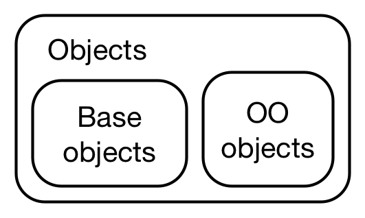
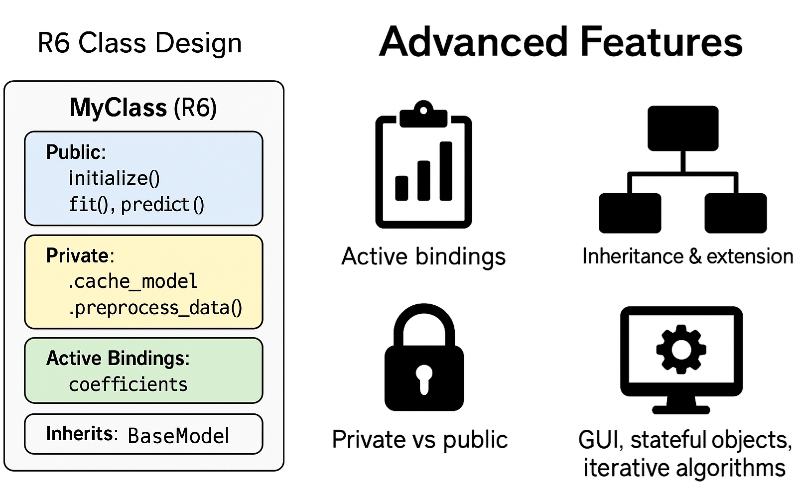

#  {visibility="hidden"}

\def\bx{\mathbf{x}}
\def\by{\mathbf{y}}
\def\bz{\mathbf{z}}
\def\bu{\mathbf{u}}
\def\bv{\mathbf{v}}
\def\bw{\mathbf{w}}
\def\bX{\mathbf{X}}
\def\bY{\mathbf{Y}}
\def\bZ{\mathbf{Z}}
\def\bU{\mathbf{U}}
\def\bV{\mathbf{V}}
\def\bW{\mathbf{W}}
\def\bI{\mathbf{I}}
\def\bH{\mathbf{H}}
\def\bS{\mathbf{S}}
\def\bD{\mathbf{D}}
\def\bbeta{\boldsymbol \beta}
\def\btheta{\boldsymbol \theta}
\def\bmu{\boldsymbol \mu}
\def\bSigma{\boldsymbol \Sigma}
\def\bLambda{\boldsymbol \Lambda}
\def\beps{\boldsymbol \epsilon}
\def\T{\text{T}}
\def\E{\mathrm{E}}
\def\var{\mathrm{Var}}
\def\cov{\mathrm{Cov}}
\def\cor{\mathrm{Corr}}
\def\se{\mathrm{se}}
\def\bias{\mathrm{bias}}
\def\mse{\mathrm{MSE}}
\def\R{\mathbb{R}}
\def\P{\mathrm{P}}
\def\iid{\stackrel{\text{iid}}{\sim}}
\DeclareMathOperator*{\argmin}{arg\,min}
\DeclareMathOperator*{\argmax}{arg\,max}

```{r}
#| label: setup
#| include: false
#| eval: true
library(knitr)
library(ggplot2)
knitr::opts_chunk$set(
    fig.asp = 0.618,
    fig.align = "center",
    out.width = "100%",
    fig.retina = 3,
    fig.path = "./images/11-oop/",
    message = FALSE,
    warning = FALSE,
    global.par = TRUE
)
options(
  htmltools.dir.version = FALSE,
  dplyr.print_min = 6, 
  dplyr.print_max = 6,
  tibble.width = 80,
  width = 80,
  digits = 4
  )
hook_output <- knitr::knit_hooks$get("output")
knitr::knit_hooks$set(output = function(x, options) {
  lines <- options$output.lines
  if (is.null(lines)) {
    return(hook_output(x, options))  # pass to default hook
  }
  x <- unlist(strsplit(x, "\n"))
  more <- "..."
  if (length(lines)==1) {        # first n lines
    if (length(x) > lines) {
      # truncate the output, but add ....
      x <- c(head(x, lines), more)
    }
  } else {
    x <- c(more, x[lines], more)
  }
  # paste these lines together
  x <- paste(c(x, ""), collapse = "\n")
  hook_output(x, options)
})
ggplot2::theme_set(ggplot2::theme_bw(base_size = 16))
```

# Object-Oriented Programming in R

<h2> OOP paradigms in R: functional vs. encapsulated </h2>
<h2> Base types and the S3 system </h2>
<h2> S4: formal classes </h2>
<h2> R6: reference semantics </h2>
<h2> S7 and best practices </h2>

::: notes
- Adapted from the SCoRT short course (OOP in R) and the course scripts S3.R, S4.R, R6.R, OO-vs-Base.R. Main reference: Hadley Wickham, *Advanced R*, 2nd ed., chapters 12-16.
- Running example: we turn the k-NN regression code from deck 03 into a proper class with methods.
:::

## Why OOP in a Statistics Course?

```{r}
#| fig-asp: 0.32
fit <- lm(mpg ~ wt, data = mtcars)
par(mfrow = c(1, 3))
plot(mtcars$wt)              # a numeric vector -> scatterplot of values
plot(iris$Species)           # a factor         -> barplot
plot(fit, which = 1)         # an lm object     -> residual plot
```

- **Same function, different behavior** depending on the **class** of the argument: *polymorphism*.
- `print()`, `summary()`, `plot()`, `predict()` work on `lm`, `glm`, `boot`, `density`, `hclust`, ... objects.
- When you write a new method (an estimator, a resampling procedure), giving it a class lets users use these familiar generics.

## Two Paradigms

:::: {.columns}
::: {.column width="50%"}
**Functional OOP** (S3, S4, S7)

- Methods belong to **generic functions**
- Call: `generic(object, ...)`, e.g. `summary(fit)`
- Objects are (mostly) **immutable**: copy-on-modify
:::
::: {.column width="50%"}
**Encapsulated OOP** (R6, Reference Classes)

- Methods belong to **objects**
- Call: `object$method(...)`, e.g. `learner$train(task)`
- Objects are **mutable**: modified in place
:::
::::

{width="40%" fig-align="center"}

## Base Types vs. OO Objects

Everything in R is an object, but not every object is object-oriented.

```{r}
x <- 1:5; f <- factor(c("a", "b", "c"))
c(is.object(x), is.object(f))     # base object vs OO object
typeof(f); attributes(f)          # an integer vector with a class attribute
unclass(f)
```

- Every object has a **base type** (`typeof()`): `"double"`, `"integer"`, `"character"`, `"list"`, `"closure"`, `"environment"`, ...
- An OO object has a `class` attribute.

# S3: Informal Classes

## S3 Basics

- **Lightweight:** no formal definition; an S3 object is a base type with a `class` attribute.

```{r}
x <- structure(list(), class = "my_class")      # create and assign class in one step
y <- list(); class(y) <- "my_class"             # create, then set class
inherits(x, "my_class")
```

- Danger: nothing stops you from doing nonsense:

```{r}
mod <- lm(log(mpg) ~ log(disp), data = mtcars)
class(mod) <- "Date"                            # turn it into a date (?!)
try(print(mod))
```

## Constructor, Validator, Helper

::: instructions
1. **Low-level constructor** `new_myclass()`: assumes inputs are OK; creates the structure efficiently.
2. **Validator** `validate_myclass()`: more expensive checks of the values.
3. **User-facing helper** `myclass()`: coerces/checks inputs, then builds + validates.
:::

```{r}
new_knnreg <- function(x = matrix(numeric()), y = numeric(), k = 1L) {
  stopifnot(is.matrix(x), is.numeric(y), is.integer(k))
  structure(list(x = x, y = y, k = k, center = colMeans(x), scale = apply(x, 2, sd)),
            class = "knnreg")
}
validate_knnreg <- function(obj) {
  if (nrow(obj$x) != length(obj$y)) stop("`x` and `y` must have the same number of observations", call. = FALSE)
  if (obj$k < 1 || obj$k > nrow(obj$x)) stop("`k` must be between 1 and n", call. = FALSE)
  if (anyNA(obj$x) || anyNA(obj$y)) stop("missing values are not allowed", call. = FALSE)
  obj
}
knnreg <- function(x, y, k = 5) {
  validate_knnreg(new_knnreg(as.matrix(x), as.numeric(y), as.integer(k)))
}
```

## Generics and Method Dispatch

- A **generic** calls `UseMethod()`, which looks for `generic.class`, then `generic.default`:

```{r}
print
predict
```

- `print(x)` with `class(x) = c("ordered", "factor")` tries `print.ordered` $\rightarrow$ `print.factor` $\rightarrow$ `print.default`.

```{r}
#| eval: !expr requireNamespace("sloop", quietly = TRUE)
sloop::s3_dispatch(print(ordered("x")))
sloop::s3_methods_class("hclust")
```

## Creating Methods for `knnreg`

```{r}
print.knnreg <- function(x, ...) {
  cat("k-NN regression with k =", x$k, "\n")
  cat("n =", nrow(x$x), "observations, p =", ncol(x$x), "predictors\n")
  invisible(x)
}
predict.knnreg <- function(object, newdata = object$x, k = object$k, ...) {
  tr <- scale(object$x, object$center, object$scale)
  te <- scale(as.matrix(newdata), object$center, object$scale)
  apply(te, 1, function(x0) mean(object$y[order(colSums((t(tr) - x0)^2))[1:k]]))
}
fit <- knnreg(mtcars[, c("wt", "qsec")], mtcars$mpg, k = 5)
fit
predict(fit, newdata = data.frame(wt = c(2, 3.5), qsec = c(20, 17)))
try(knnreg(mtcars[, c("wt", "qsec")], mtcars$mpg, k = 100))
```

## A New Generic

```{r}
#| fig-asp: 0.36
cv_error <- function(object, ...) UseMethod("cv_error")         # the generic
cv_error.knnreg <- function(object, ks = 1:15, folds = 5, ...) {
  n <- nrow(object$x); fold <- sample(rep(1:folds, length.out = n))
  sapply(ks, function(k) mean(sapply(1:folds, function(f) {
    sub <- knnreg(object$x[fold != f, , drop = FALSE], object$y[fold != f], k)
    mean((object$y[fold == f] - predict(sub, object$x[fold == f, , drop = FALSE]))^2)
  })))
}
set.seed(4750)
plot(1:15, cv_error(fit), type = "b", pch = 19, xlab = "k", ylab = "5-fold CV error")
```

## Inheritance and `NextMethod()`

```{r}
# a weighted version: closer neighbors get larger weights
wknnreg <- function(x, y, k = 5) {
  obj <- knnreg(x, y, k)
  class(obj) <- c("wknnreg", class(obj))          # subclass first
  obj
}
print.wknnreg <- function(x, ...) {
  cat("(distance-weighted) ")
  NextMethod()                                    # then call print.knnreg
}
wfit <- wknnreg(mtcars[, c("wt", "qsec")], mtcars$mpg, k = 5)
class(wfit)
wfit
```

::: question
We did not write `predict.wknnreg()`. Which method will `predict(wfit, ...)` use? Write the weighted version.
:::

## S3 for Things You Already Use

```{r}
methods(class = "density")
d <- density(faithful$eruptions)
class(d); names(d)
```

- `boot()` (Ch 8), `density()` (Ch 12), `hclust()` (clustering), `optim()` (Ch 14) all return objects with methods; reading the method source is the best way to learn what they compute: `getS3method("print", "density")`.

# S4: Formal Classes

## S4: Classes with Slots

```{r}
setClass("KNNReg",
  slots = c(x = "matrix", y = "numeric", k = "integer"),
  validity = function(object) {
    if (nrow(object@x) != length(object@y)) return("x and y have different numbers of rows")
    if (object@k < 1L) return("k must be positive")
    TRUE
  })
m4 <- new("KNNReg", x = as.matrix(mtcars[, c("wt", "qsec")]), y = mtcars$mpg, k = 5L)
m4@k                           # slot access via @
slot(m4, "k")
isVirtualClass("KNNReg")
try(new("KNNReg", x = matrix(1:4, 2), y = 1:3, k = 1L))
```

## S4 Generics and Methods

```{r}
setGeneric("fitted_knn", function(object, ...) standardGeneric("fitted_knn"))
setMethod("fitted_knn", "KNNReg", function(object, ...) {
  X <- scale(object@x)
  apply(X, 1, function(x0) mean(object@y[order(colSums((t(X) - x0)^2))[1:object@k]]))
})
setMethod("show", "KNNReg", function(object) {
  cat("<KNNReg> k =", object@k, " n =", nrow(object@x), "\n")
})
m4
head(fitted_knn(m4))
```

## S4 Inheritance and Multiple Dispatch

```{r}
setClass("WKNNReg", contains = "KNNReg", slots = c(power = "numeric"))
w4 <- new("WKNNReg", m4, power = 2)
is(w4, "KNNReg")
w4                                                # inherits show()
setGeneric("combine", function(a, b) standardGeneric("combine"))
setMethod("combine", signature("KNNReg", "numeric"), function(a, b) "model + number")
setMethod("combine", signature("numeric", "KNNReg"), function(a, b) "number + model")
c(combine(m4, 1), combine(1, m4))                  # dispatch on BOTH arguments
```

- S4 is used heavily in Bioconductor and in `Matrix`, `lme4`, ...

# R6: Reference Semantics

## R6 Classes

```{r}
library(R6)
Accumulator <- R6Class("Accumulator", list(
  sum = 0,
  add = function(x = 1) {
    self$sum <- self$sum + x
    invisible(self)                    # return self to allow method chaining
  })
)
x <- Accumulator$new()
x$add(4)
x$sum
x$add(10)$add(10)$sum
```

## Reference Semantics: Objects Are Not Copied

```{r}
y1 <- Accumulator$new()
y2 <- y1                               # NOT a copy: same object
y1$add(10)
c(y1 = y1$sum, y2 = y2$sum)
y3 <- y1$clone()                       # an explicit copy
y1$add(5); c(y1 = y1$sum, y3 = y3$sum)
```

- Contrast with S3/S4 where `y2 <- y1; modify(y1)` leaves `y2` unchanged.

## An R6 Online Learner

```{r}
RunningMoments <- R6Class("RunningMoments",
  public = list(
    initialize = function() invisible(self),
    update = function(x) {                       # Welford's algorithm (Ch 13: numerically stable)
      for (xi in x) {
        private$n <- private$n + 1
        delta <- xi - private$mu
        private$mu <- private$mu + delta / private$n
        private$m2 <- private$m2 + delta * (xi - private$mu)
      }
      invisible(self)
    },
    print = function(...) cat("n =", private$n, " mean =", private$mu, " var =", self$var, "\n")
  ),
  private = list(n = 0, mu = 0, m2 = 0),
  active = list(var = function() private$m2 / (private$n - 1))
)
set.seed(4750); rm1 <- RunningMoments$new()
rm1$update(rnorm(1000))$update(rnorm(1000, 1)); rm1
```

## R6 Features

:::: {.columns}
::: {.column width="55%"}
- `public`, `private`, and `active` fields
- `initialize()` constructor, `print()` method
- Inheritance: `R6Class("Child", inherit = Parent)`, `super$method()`
- `clone(deep = TRUE)`
- Used by `shiny` (sessions), `mlr3`, `torch`, `httr2`
:::
::: {.column width="45%"}
{width="100%"}
:::
::::

## S7: The New OOP System

- Designed by the R Consortium to unify S3 + S4 and fix their issues: formal properties, validation, multiple dispatch, S3/S4 compatibility.

```{r}
#| eval: !expr requireNamespace("S7", quietly = TRUE)
library(S7)
Circle <- new_class("Circle", properties = list(radius = class_double))
area <- new_generic("area", "shape")
method(area, Circle) <- function(shape) pi * shape@radius^2
c1 <- Circle(radius = 5)
c1
area(c1)
```

## Trade-offs and Best Practices

| Paradigm | Pros | Cons |
|----------|------|------|
| S3 | Simple, flexible, ubiquitous | No schema, fragile dispatch |
| S4 | Formal, robust, multiple dispatch | Verbose, steeper learning curve |
| R6 | Encapsulated, mutable, fast | Not idiomatic for most stats objects |
| S7 | Unified, type-safe | Newer, evolving ecosystem |

::: instructions
- For a statistical method: **S3** with constructor/validator/helper + `print`, `summary`, `predict`, `plot` methods.
- Use **R6** when state must change in place (simulations, online algorithms, apps).
- Document constructors and methods; write unit tests (next lecture: R packages).
:::

::: your-turn
Write an S3 class `mcint` returned by `mc_integrate(g, a, b, m)` (Ch 6) with `print` (estimate and SE) and `plot` (running mean with $\pm 2$ SE bands) methods.
:::
