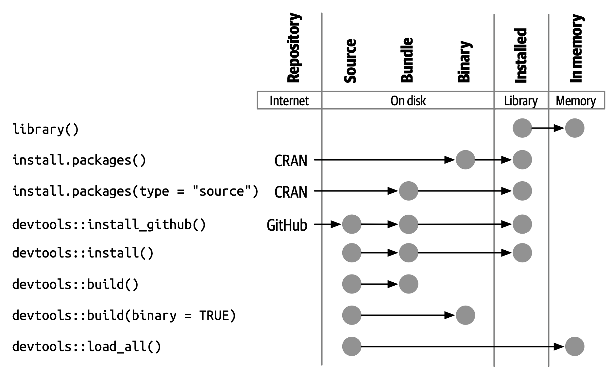
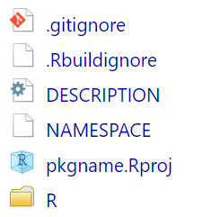
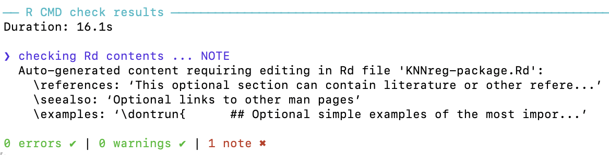
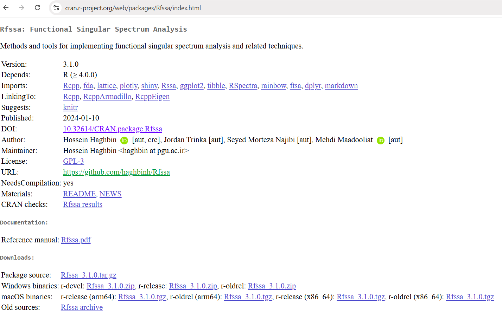

#  {visibility="hidden"}

\def\bx{\mathbf{x}}
\def\by{\mathbf{y}}
\def\bz{\mathbf{z}}
\def\bu{\mathbf{u}}
\def\bv{\mathbf{v}}
\def\bw{\mathbf{w}}
\def\bX{\mathbf{X}}
\def\bY{\mathbf{Y}}
\def\bZ{\mathbf{Z}}
\def\bU{\mathbf{U}}
\def\bV{\mathbf{V}}
\def\bW{\mathbf{W}}
\def\bI{\mathbf{I}}
\def\bH{\mathbf{H}}
\def\bS{\mathbf{S}}
\def\bD{\mathbf{D}}
\def\bbeta{\boldsymbol \beta}
\def\btheta{\boldsymbol \theta}
\def\bmu{\boldsymbol \mu}
\def\bSigma{\boldsymbol \Sigma}
\def\bLambda{\boldsymbol \Lambda}
\def\beps{\boldsymbol \epsilon}
\def\T{\text{T}}
\def\E{\mathrm{E}}
\def\var{\mathrm{Var}}
\def\cov{\mathrm{Cov}}
\def\cor{\mathrm{Corr}}
\def\se{\mathrm{se}}
\def\bias{\mathrm{bias}}
\def\mse{\mathrm{MSE}}
\def\R{\mathbb{R}}
\def\P{\mathrm{P}}
\def\iid{\stackrel{\text{iid}}{\sim}}
\DeclareMathOperator*{\argmin}{arg\,min}
\DeclareMathOperator*{\argmax}{arg\,max}

```{r}
#| label: setup
#| include: false
#| eval: true
library(knitr)
library(ggplot2)
knitr::opts_chunk$set(
    fig.asp = 0.618,
    fig.align = "center",
    out.width = "100%",
    fig.retina = 3,
    fig.path = "./images/12-rpkg/",
    message = FALSE,
    warning = FALSE,
    global.par = TRUE
)
options(
  htmltools.dir.version = FALSE,
  dplyr.print_min = 6, 
  dplyr.print_max = 6,
  tibble.width = 80,
  width = 80,
  digits = 4
  )
hook_output <- knitr::knit_hooks$get("output")
knitr::knit_hooks$set(output = function(x, options) {
  lines <- options$output.lines
  if (is.null(lines)) {
    return(hook_output(x, options))  # pass to default hook
  }
  x <- unlist(strsplit(x, "\n"))
  more <- "..."
  if (length(lines)==1) {        # first n lines
    if (length(x) > lines) {
      # truncate the output, but add ....
      x <- c(head(x, lines), more)
    }
  } else {
    x <- c(more, x[lines], more)
  }
  # paste these lines together
  x <- paste(c(x, ""), collapse = "\n")
  hook_output(x, options)
})
ggplot2::theme_set(ggplot2::theme_bw(base_size = 16))
```

# Developing an R Package

<h2> Why packages? Package structure and states </h2>
<h2> DESCRIPTION, NAMESPACE, R/, man/ </h2>
<h2> Documentation with roxygen2 and tests with testthat </h2>
<h2> Building a package from scratch (live, with base R) </h2>
<h2> Checking, GitHub, and CRAN </h2>

::: notes
- Adapted from the STAR-DS and SCoRT short courses (R package / CRAN submission). Main reference: Wickham and Bryan, *R Packages*, 2nd ed., <https://r-pkgs.org/>.
- Running example: package the S3 `knnreg` class from the OOP lecture into a package `knnreg`.
:::

## R Packages: The Fundamental Unit

In R, the **fundamental unit of shareable code** is the **package**. A package bundles together

- **code** (functions, classes, methods),
- **data**,
- **documentation** (help pages, vignettes),
- **tests**,

all in one place, easy to share, install, and cite.

::: question
You already use packages: `install.packages("boot")`, `library(boot)`, `help(package = "boot")`. What would it take to make **your** HW functions installable like that?
:::

## Why Write a Package?

- To **share** your code (classmates, collaborators, your future self)
- To make your code easy to **install, use, and learn**
- To save time with **conventions**: R CMD check finds problems you didn't know you had
- Research software (e.g. an estimator from a paper) is expected to be a package
- Course connection: the `knnreg` class, a Monte Carlo integrator, a bootstrap function ... all are package-sized

## Package Structure

```text
knnreg/
├── DESCRIPTION         # package metadata
├── NAMESPACE           # exported functions & imports
├── R/                  # your R functions
├── man/                # documentation (.Rd), generated by roxygen2
├── tests/              # unit tests with testthat
├── data/               # data sets (.rda)
├── src/                # C/C++ code (Rcpp, Ch 15)
├── vignettes/          # long-form documentation (Rmd/qmd)
└── inst/               # installed as-is (e.g. inst/app/ for a Shiny app, extdata/)
```

::: tip
Only `DESCRIPTION`, `NAMESPACE`, and `R/` are required; add the others as needed.
:::

## Package States

- **Source:** the editable folder.
- **Bundled:** a `.tar.gz` built from source (`R CMD build`); portable, not yet usable.
- **Binary:** precompiled for one OS (`.zip` on Windows, `.tgz` on macOS).
- **Installed:** unpacked into a library folder (`R CMD INSTALL`, `install.packages()`).
- **In-memory:** loaded into a session (`library()`, or `devtools::load_all()` during development).

{width="45%" fig-align="center"}

## System Setup

```{.r}
install.packages(c("devtools", "usethis", "roxygen2", "testthat", "knitr", "rmarkdown"))
devtools::has_devel()          # do you have a working build toolchain?
```

- **Windows:** install [Rtools](https://cran.r-project.org/bin/windows/Rtools/) (matching your R version) for packages with compiled code.
- **macOS:** `xcode-select --install`.
- `usethis` creates files and folders; `devtools` builds, documents, tests, and checks; `roxygen2` writes help pages and the NAMESPACE.

## Choosing a Name and Creating the Package

A valid name contains only letters, numbers, and periods, starts with a letter, and does not end with a period. Check availability: `available::available("knnreg")`.

```{.r}
usethis::create_package("~/R/knnreg")   # opens a new RStudio/Positron project
usethis::use_mit_license()
usethis::use_r("knnreg")                 # creates R/knnreg.R
usethis::use_testthat()
usethis::use_test("knnreg")              # creates tests/testthat/test-knnreg.R
usethis::use_data(mydata)                # saves data/mydata.rda
usethis::use_git(); usethis::use_github()
```

{width="45%" fig-align="center"}

## The DESCRIPTION File

```{.yaml}
Package: knnreg
Title: k-Nearest-Neighbor Regression with S3 Methods
Version: 0.1.0
Authors@R: person("First", "Last", email = "first.last@marquette.edu", role = c("aut", "cre"))
Description: Fits k-nearest-neighbor regression models, with print, predict,
    and cross-validation methods. Written for MATH 4750 Computational Statistics.
License: MIT + file LICENSE
Encoding: UTF-8
Roxygen: list(markdown = TRUE)
RoxygenNote: 7.3.2
Imports: stats
Suggests: testthat (>= 3.0.0), shiny
Config/testthat/edition: 3
```

- **Imports:** needed for your package to work (installed automatically). **Suggests:** optional (tests, vignettes, apps). Never call `library()` inside package code; use `pkg::fun()` or `@importFrom`.

## The NAMESPACE File

```text
# Generated by roxygen2: do not edit by hand

S3method(predict,knnreg)
S3method(print,knnreg)
export(cv_error)
export(knnreg)
importFrom(stats,sd)
```

- `export()`: functions users can call. Everything else is internal (`knnreg:::helper`).
- `S3method()`: registers methods for generics.
- `importFrom()`: functions you use from other packages.
- Generated from roxygen tags by `devtools::document()`.

## Documenting with roxygen2

```{.r}
#' Fit a k-nearest-neighbor regression
#'
#' @param x A numeric matrix or data frame of predictors.
#' @param y A numeric response vector.
#' @param k Number of neighbors.
#' @return An object of class `knnreg`.
#' @examples
#' fit <- knnreg(mtcars[, c("wt", "qsec")], mtcars$mpg, k = 5)
#' predict(fit, data.frame(wt = 3, qsec = 18))
#' @export
knnreg <- function(x, y, k = 5) {
  validate_knnreg(new_knnreg(as.matrix(x), as.numeric(y), as.integer(k)))
}

#' @export
predict.knnreg <- function(object, newdata = object$x, k = object$k, ...) { ... }
```

`devtools::document()` turns these comments into `man/knnreg.Rd` and the NAMESPACE.

## Testing with testthat

```{.r}
# tests/testthat/test-knnreg.R
test_that("k = n predicts the mean", {
  fit <- knnreg(mtcars[, c("wt", "qsec")], mtcars$mpg, k = nrow(mtcars))
  expect_equal(predict(fit, data.frame(wt = 3, qsec = 18)), mean(mtcars$mpg))
})
test_that("invalid k is an error", {
  expect_error(knnreg(mtcars[, 1:2], mtcars$mpg, k = 0), "between 1 and n")
})
```

```{r}
#| eval: !expr requireNamespace("testthat", quietly = TRUE)
library(testthat)
test_that("the sample mean is the k = n k-NN fit", {
  y <- c(3, 1, 4, 1, 5)
  expect_equal(mean(y[order(abs(1:5 - 2))[1:5]]), mean(y))
})
```

## The Development Loop

```{r}
#| echo: false
#| fig-asp: 0.3
par(mar = c(0, 0, 0, 0))
plot(NA, xlim = c(0, 12), ylim = c(0, 2), axes = FALSE)
steps <- c("edit R/*.R", "load_all()\nCtrl+Shift+L", "try it in\nthe console", "document()\nCtrl+Shift+D", "test()\nCtrl+Shift+T", "check()\nCtrl+Shift+E")
for (i in seq_along(steps)) {
  rect(2 * i - 1.9, 0.5, 2 * i - 0.2, 1.5, col = c("#FFCC00", "#88A0C8")[(i %% 2) + 1], border = NA)
  text(2 * i - 1.05, 1, steps[i], cex = 1.15)
  if (i < 6) arrows(2 * i - 0.15, 1, 2 * i + 0.05, 1, length = .08, lwd = 2)
}
```

- `devtools::load_all()` simulates installing and attaching: fast iteration without reinstalling.
- `devtools::check()` runs **R CMD check**: the gold standard.

{width="40%" fig-align="center"}

# Build a Package from Scratch (Live)

## Step 1: Create the Source Folder with Base R

No helper packages needed: a package is just files.

```{r}
pkg <- file.path(tempdir(), "knnreg")
unlink(pkg, recursive = TRUE); dir.create(file.path(pkg, "R"), recursive = TRUE)
writeLines(c(
  "Package: knnreg",
  "Title: k-Nearest-Neighbor Regression with S3 Methods",
  "Version: 0.1.0",
  "Authors@R: person('MATH', 'Student', email = 'student@marquette.edu', role = c('aut', 'cre'))",
  "Description: Fits k-nearest-neighbor regression models with print and predict methods.",
  "License: MIT + file LICENSE",
  "Encoding: UTF-8",
  "Imports: stats"), file.path(pkg, "DESCRIPTION"))
writeLines(c("YEAR: 2027", "COPYRIGHT HOLDER: knnreg authors"), file.path(pkg, "LICENSE"))
writeLines(c("export(knnreg)", "S3method(print,knnreg)", "S3method(predict,knnreg)", "importFrom(stats,sd)"),
           file.path(pkg, "NAMESPACE"))
```

## Step 2: Add the Code

```{r}
code <- '
knnreg <- function(x, y, k = 5) {
  x <- as.matrix(x); y <- as.numeric(y); k <- as.integer(k)
  if (nrow(x) != length(y)) stop("`x` and `y` must have the same number of observations")
  if (k < 1 || k > nrow(x)) stop("`k` must be between 1 and n")
  structure(list(x = x, y = y, k = k, center = colMeans(x), scale = apply(x, 2, sd)), class = "knnreg")
}
print.knnreg <- function(x, ...) {
  cat("k-NN regression with k =", x$k, "on", nrow(x$x), "observations\\n"); invisible(x)
}
predict.knnreg <- function(object, newdata = object$x, k = object$k, ...) {
  tr <- scale(object$x, object$center, object$scale)
  te <- scale(as.matrix(newdata), object$center, object$scale)
  apply(te, 1, function(x0) mean(object$y[order(colSums((t(tr) - x0)^2))[1:k]]))
}'
writeLines(code, file.path(pkg, "R", "knnreg.R"))
list.files(pkg, recursive = TRUE)
```

## Step 3: Build, Install, and Use

```{r}
lib <- file.path(tempdir(), "lib"); dir.create(lib, showWarnings = FALSE)
owd <- setwd(tempdir())
out <- system2(file.path(R.home("bin"), "R"), c("CMD", "build", "--no-manual", "knnreg"), stdout = TRUE)
tail(out, 2)
tarball <- list.files(pattern = "^knnreg_.*tar.gz$")
install.packages(tarball, lib = lib, repos = NULL, type = "source", quiet = TRUE)
setwd(owd)
library(knnreg, lib.loc = lib)
fit <- knnreg(mtcars[, c("wt", "qsec")], mtcars$mpg, k = 5)
fit
predict(fit, data.frame(wt = c(2, 3.5), qsec = c(20, 17)))
```

::: notes
- In practice use devtools::build() and devtools::install(); here we show that only base R is needed.
- Note the bundled tarball name: knnreg_0.1.0.tar.gz.
:::

## Data, Compiled Code, and Apps in a Package

- **Data:** `usethis::use_data(df)` $\rightarrow$ `data/df.rda`; document it in `R/data.R` with `@format` and `@source`.
- **C++ (Ch 15):** `usethis::use_rcpp()`; put code in `src/`; `// [[Rcpp::export]]`; `LinkingTo: Rcpp` in DESCRIPTION.
- **Shiny app:** put it in `inst/app/app.R` and export a launcher:

```{.r}
#' Launch the k-NN explorer
#' @export
run_explorer <- function() {
  app_dir <- system.file("app", package = "knnreg")
  shiny::runApp(app_dir, display.mode = "normal")
}
```

## Sharing: GitHub and CRAN

:::: {.columns}
::: {.column width="50%"}
**GitHub**

```{.r}
usethis::use_git()
usethis::use_github()
usethis::use_readme_rmd()
usethis::use_github_action("check-standard")
# users install with
remotes::install_github("user/knnreg")
```
:::
::: {.column width="50%"}
**CRAN checklist**

- `R CMD check --as-cran`: 0 ERRORs, 0 WARNINGs, minimal NOTEs
- All exported functions documented, examples run in < 5 s
- Valid license, plain-text Title/Description
- `rhub::rhub_check()` on Windows/macOS/Linux
- `devtools::release()` (or the web form)
:::
::::

{width="38%" fig-align="center"}

## After Submission

- Automated confirmation e-mail; a CRAN maintainer reviews within days.
- They may accept, request fixes, or reject with reasons. Respond politely and resubmit with a bumped version (1.0.0 $\rightarrow$ 1.0.1) and `cran-comments.md`.
- Keep a `NEWS.md`; tag releases on GitHub.

## Summary

::: instructions
- A package = DESCRIPTION + NAMESPACE + R/ (+ man/, tests/, data/, src/, inst/, vignettes/).
- `usethis` creates; `roxygen2` documents; `testthat` tests; `devtools` loads, builds, and checks.
- The loop: edit $\rightarrow$ `load_all()` $\rightarrow$ `document()` $\rightarrow$ `test()` $\rightarrow$ `check()`.
- Share via GitHub; submit to CRAN when `check()` is clean.
:::

::: your-turn
**Final-project tip:** turn your project code into a small package with at least two exported, documented functions, one S3 class with a `print` method, and three unit tests.
:::
