#  {visibility="hidden"}

\def\bx{\mathbf{x}}
\def\by{\mathbf{y}}
\def\bz{\mathbf{z}}
\def\bu{\mathbf{u}}
\def\bv{\mathbf{v}}
\def\bw{\mathbf{w}}
\def\bX{\mathbf{X}}
\def\bY{\mathbf{Y}}
\def\bZ{\mathbf{Z}}
\def\bU{\mathbf{U}}
\def\bV{\mathbf{V}}
\def\bW{\mathbf{W}}
\def\bI{\mathbf{I}}
\def\bH{\mathbf{H}}
\def\bS{\mathbf{S}}
\def\bD{\mathbf{D}}
\def\bbeta{\boldsymbol \beta}
\def\btheta{\boldsymbol \theta}
\def\bmu{\boldsymbol \mu}
\def\bSigma{\boldsymbol \Sigma}
\def\bLambda{\boldsymbol \Lambda}
\def\beps{\boldsymbol \epsilon}
\def\T{\text{T}}
\def\E{\mathrm{E}}
\def\var{\mathrm{Var}}
\def\cov{\mathrm{Cov}}
\def\cor{\mathrm{Corr}}
\def\se{\mathrm{se}}
\def\bias{\mathrm{bias}}
\def\mse{\mathrm{MSE}}
\def\R{\mathbb{R}}
\def\P{\mathrm{P}}
\def\iid{\stackrel{\text{iid}}{\sim}}
\DeclareMathOperator*{\argmin}{arg\,min}
\DeclareMathOperator*{\argmax}{arg\,max}

```{r}
#| label: setup
#| include: false
#| eval: true
library(knitr)
library(ggplot2)
knitr::opts_chunk$set(
    fig.asp = 0.618,
    fig.align = "center",
    out.width = "100%",
    fig.retina = 3,
    fig.path = "./images/21-dlir/",
    message = FALSE,
    warning = FALSE,
    global.par = TRUE
)
options(
  htmltools.dir.version = FALSE,
  dplyr.print_min = 6, 
  dplyr.print_max = 6,
  tibble.width = 80,
  width = 80,
  digits = 4
  )
hook_output <- knitr::knit_hooks$get("output")
knitr::knit_hooks$set(output = function(x, options) {
  lines <- options$output.lines
  if (is.null(lines)) {
    return(hook_output(x, options))  # pass to default hook
  }
  x <- unlist(strsplit(x, "\n"))
  more <- "..."
  if (length(lines)==1) {        # first n lines
    if (length(x) > lines) {
      # truncate the output, but add ....
      x <- c(head(x, lines), more)
    }
  } else {
    x <- c(more, x[lines], more)
  }
  # paste these lines together
  x <- paste(c(x, ""), collapse = "\n")
  hook_output(x, options)
})
ggplot2::theme_set(ggplot2::theme_bw(base_size = 16))
```

# Deep Learning in R

<h2> Lecture A: myths and truths, anatomy of a neural network, a network from scratch </h2>
<h2> Lecture B: fully connected networks with Keras (MNIST) </h2>
<h2> Lecture C: convolutional neural networks, and beyond (RNN, embeddings, autoencoders) </h2>

::: notes
- Adapted from the SCoRT short course (Deep Learning in R) and the previous 7-DLiR.FCN.CNN slides. Keras code is shown but not run when the slides are rendered (it needs TensorFlow); everything else is live R.
- Course scripts: MNIST.R, MNIST-CNN.R, Image-Classification.R, Text-Classification.R, surres-mulogo.R.
:::

# Lecture A: Neural Network Fundamentals {#part-a}

## Deep Learning: Myths and Truths

:::: {.columns}
::: {.column width="55%"}
- Often presented as algorithms that "work like the brain", that "think" or "understand". Reality is far from this.
- **AI:** the effort to automate intellectual tasks normally performed by humans.
- **ML:** rather than programmers crafting rules by hand, can a computer **learn the rules** by looking at data?
- **DL:** ML with many successive **layers** of learned representations.
:::
::: {.column width="45%"}
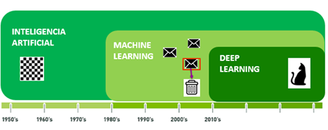{width="90%"}
:::
::::

## Classical Programming vs. Machine Learning

:::: {.columns}
::: {.column width="50%"}
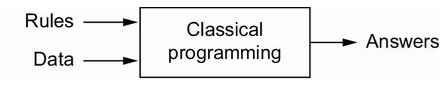{width="85%"}
:::
::: {.column width="50%"}
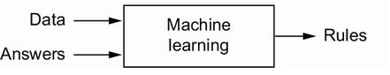{width="85%"}
:::
::::

**Recipe of an ML algorithm:** input data points (sound files, images), examples of the expected output (transcripts, tags), and a way to **measure** the distance between current and expected output; this feedback signal adjusts the algorithm: **learning**.

## Anatomy of a Neural Network

:::: {.columns}
::: {.column width="50%"}
- **Input data** and corresponding **targets**
- **Layers**, combined into a network (model)
- The **loss function**: the feedback signal used for learning
- The **optimizer**: how learning proceeds (gradient descent via **backpropagation**)
:::
::: {.column width="50%"}
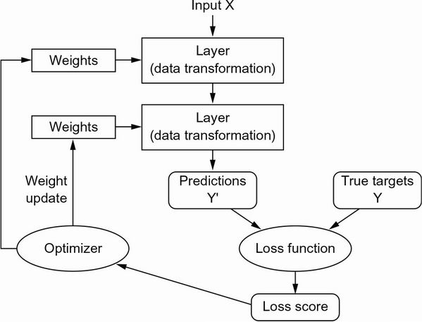{width="95%"}
:::
::::

## LeNet-5 and Why the 30-Year Gap

:::: {.columns}
::: {.column width="55%"}
- 1989, Bell Labs: Yann LeCun combines convolutional networks with backpropagation for handwritten digits; LeNet read ZIP codes for the USPS and checks (32x32 pixels) for banks.
- 2011-2012: GPU-trained deep nets win ImageNet; AlexNet (Krizhevsky, Hinton) reaches 83.6% top-5 accuracy (vs 74.3% in 2011).
- Three forces: **hardware**, **datasets and benchmarks**, **algorithmic advances** (ReLU, dropout, better initialization and optimizers).
:::
::: {.column width="45%"}
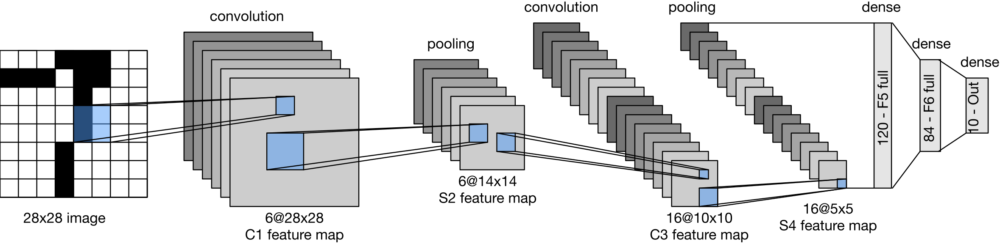{width="100%"}

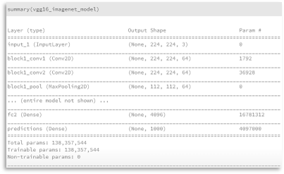{width="80%"}
:::
::::

## A Neuron and Activation Functions

A layer computes $\bz = \sigma(\bW\bx + \mathbf b)$: an affine map followed by an elementwise **activation** $\sigma$.

```{r}
#| fig-asp: 0.33
z <- seq(-4, 4, length = 400)
acts <- cbind(sigmoid = 1 / (1 + exp(-z)), tanh = tanh(z), ReLU = pmax(z, 0), linear = z / 4)
matplot(z, acts, type = "l", lty = 1, lwd = 3, col = c("#003366", "#C0392B", "#27AE60", "gray50"),
        ylab = expression(sigma(z)), main = "Activation functions")
legend("topleft", colnames(acts), col = c("#003366", "#C0392B", "#27AE60", "gray50"), lwd = 3, bty = "n")
```

## Linear Activation: Hidden Layers Disappear

$$
\bz = \bW_1\bx + \mathbf b_1,\qquad \by = \bW_2\bz + \mathbf b_2 = (\bW_2\bW_1)\bx + (\bW_2\mathbf b_1 + \mathbf b_2).
$$

A network with **linear** activations is just a **linear model**, no matter how many layers. Nonlinear activations are what make depth useful.

## Residual (Sur)Realism: The MU Logo Data

An "inverse problem" dataset: $Y$ and five predictors constructed so that the **residual plot** of the linear model reveals a picture.

```{r}
#| fig-asp: 0.45
mu.logo <- read.csv("data/mu-logo.csv")
dim(mu.logo)
lm.fit <- lm(Y ~ X1 + X2 + X3 + X4 + X5, data = mu.logo)
plot(lm.fit$fitted.values, lm.fit$residuals, pch = ".", col = "#003366",
     xlab = expression(hat(Y)), ylab = expression(hat(e)), main = "Residuals vs fitted values")
```

## Regression with a Neural Network

A one-hidden-layer network with **linear** output (`nnet`, recommended package) should reproduce the linear fit:

```{r}
library(nnet)
set.seed(4750)
net0 <- nnet(Y ~ ., data = mu.logo, size = 0, skip = TRUE, linout = TRUE, trace = FALSE)   # no hidden layer
rbind(lm = coef(lm.fit), nnet = coef(net0)[c("b->o", paste0("i", 1:5, "->o"))]) |> round(4)
```

- With `neuralnet::neuralnet(Y ~ ., hidden = c(10, 10), act.fct = function(x) x)`, the product of the weight matrices recovers the same coefficients (previous years' slides).

## A Two-Layer Network from Scratch: Backpropagation

```{r}
mlp_fit <- function(X, y, H = 10, lr = 0.05, epochs = 3000, seed = 4750) {
  set.seed(seed); p <- ncol(X); n <- nrow(X)
  W1 <- matrix(rnorm(p * H, sd = 1 / sqrt(p)), p, H); b1 <- rep(0, H)
  W2 <- rnorm(H, sd = 1 / sqrt(H)); b2 <- 0; loss <- numeric(epochs)
  for (e in 1:epochs) {
    A <- X %*% W1 + matrix(b1, n, H, byrow = TRUE); Z <- tanh(A)     # forward pass
    yhat <- as.vector(Z %*% W2 + b2); r <- yhat - y
    loss[e] <- mean(r^2)
    g_yhat <- 2 * r / n                                               # backward pass (chain rule)
    gW2 <- crossprod(Z, g_yhat); gb2 <- sum(g_yhat)
    gZ <- outer(g_yhat, W2); gA <- gZ * (1 - Z^2)
    gW1 <- crossprod(X, gA); gb1 <- colSums(gA)
    W1 <- W1 - lr * gW1; b1 <- b1 - lr * gb1; W2 <- W2 - lr * as.vector(gW2); b2 <- b2 - lr * gb2
  }
  list(predict = function(Xn) as.vector(tanh(Xn %*% W1 + matrix(b1, nrow(Xn), H, byrow = TRUE)) %*% W2 + b2),
       loss = loss)
}
```

## Fitting a Nonlinear Function

```{r}
#| fig-asp: 0.36
set.seed(4750); x <- sort(runif(200, -3, 3)); y <- sin(2 * x) + 0.3 * x + rnorm(200, sd = 0.2)
fit <- mlp_fit(matrix(x), y, H = 15, lr = 0.1, epochs = 5000)
par(mfrow = c(1, 2))
plot(fit$loss, type = "l", log = "y", lwd = 2, xlab = "epoch", ylab = "training MSE", main = "Gradient descent")
plot(x, y, pch = 20, col = "gray50", main = "15 tanh hidden units")
lines(x, fit$predict(matrix(x)), lwd = 3, col = "#C0392B"); lines(x, sin(2 * x) + 0.3 * x, lty = 2, lwd = 2)
```

::: notes
- This is exactly what Keras does, with automatic differentiation instead of hand-coded gradients, mini-batches (SGD), and better optimizers (RMSprop, Adam).
:::

## Some Neural Network Packages in R

| Package | Description |
|---|---|
| `nnet` | feed-forward networks with a single hidden layer; multinomial log-linear models |
| `neuralnet` | training by backpropagation; plots of the network |
| `keras3` / `tensorflow` | interface to Keras 3 and TensorFlow (CPU/GPU/TPU) |
| `torch` | native R interface to libtorch (no Python needed) |
| `h2o`, `RSNNS`, `deepnet` | other toolkits |

::: tip
`torch` for R installs without Python; `keras3` needs a Python environment (e.g. conda env `py39`) with TensorFlow.
:::

# Lecture B: Fully Connected Networks with Keras {#part-b}

## Why TensorFlow and Keras in R?

:::: {.columns}
::: {.column width="55%"}
- **TensorFlow:** hardware independent (CPU, GPU, TPU), **automatic differentiation**, distributed execution, optimizers (SGD, Adam) that don't need all data in RAM, deployable models.
- You define the graph in R; it is compiled, optimized, and executed; **tensors** flow between the nodes.
- **Keras:** a user-friendly API; same code on CPU or GPU; quick prototyping.
:::
::: {.column width="45%"}
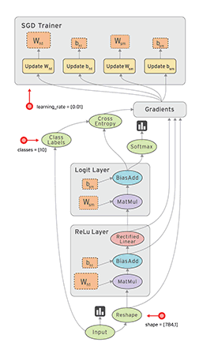{width="80%"}
:::
::::

## Real-World Examples of Data Tensors

| Tensor | Shape | Example |
|---|---|---|
| 2D | (samples, features) | tabular data |
| 3D | (samples, timesteps, features) | time series, text |
| 3D | (samples, height, width) | grayscale images (MNIST) |
| 4D | (samples, height, width, channels) | color images |
| 5D | (samples, frames, height, width, channels) | video |

```{r}
x <- array(runif(2 * 28 * 28), dim = c(2, 28, 28))     # a 3D tensor: two 28 x 28 "images"
dim(x)
flat <- matrix(aperm(x, c(1, 3, 2)), nrow = 2)         # flatten each image row by row (like keras array_reshape)
dim(flat)
```

## Installing Keras

```{.r}
install.packages("keras3")            # or remotes::install_github("rstudio/keras3")
library(keras3)
keras3::install_keras(backend = "tensorflow")    # needs Python (e.g. Anaconda / an existing conda env)
tensorflow::tf_config()
```

- GPU support requires NVIDIA drivers, CUDA, and cuDNN: see <https://tensorflow.rstudio.com/install/>.

## Developing a Deep Network with Keras: Four Steps

::: instructions
1. **Define the training data:** input tensors and target tensors.
2. **Define a network of layers** (a model) mapping inputs to targets.
3. **Configure learning:** a loss function, an optimizer, metrics to monitor (`compile()`).
4. **Iterate on the training data:** `fit()`.
:::

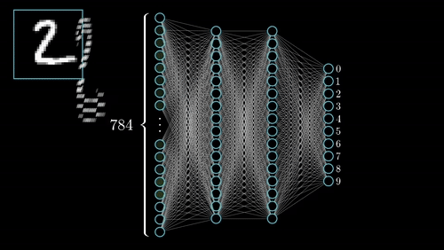{width="55%" fig-align="center"}

## Step 1: Data Preprocessing (MNIST)

```{.r}
library(keras3)
# MNIST: 60,000 training and 10,000 test images of handwritten digits, 28 x 28 pixels
c(c(x_train, y_train), c(x_test, y_test)) %<-% dataset_mnist()
# flatten images and rescale gray levels into [0, 1]
x_train <- array_reshape(x_train, c(nrow(x_train), 784)) / 255
x_test  <- array_reshape(x_test,  c(nrow(x_test),  784)) / 255
# convert class vectors to binary class matrices (one-hot encoding)
y_train <- to_categorical(y_train, 10)
y_test  <- to_categorical(y_test, 10)
```

## Step 2: Model Definition

:::: {.columns}
::: {.column width="55%"}
```{.r}
model <- keras_model_sequential(input_shape = c(784)) |>
  layer_dense(units = 256, activation = "relu") |>
  layer_dropout(rate = 0.4) |>
  layer_dense(units = 128, activation = "relu") |>
  layer_dropout(rate = 0.3) |>
  layer_dense(units = 10, activation = "softmax")
summary(model)
```
:::
::: {.column width="45%"}
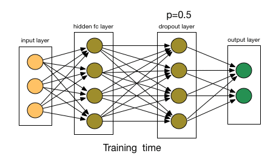{width="85%"}
:::
::::

**Number of parameters:**

```{r}
c(layer1 = (784 + 1) * 256, layer2 = (256 + 1) * 128, output = (128 + 1) * 10,
  total = (784 + 1) * 256 + (256 + 1) * 128 + (128 + 1) * 10)
```

## Softmax and Cross-Entropy

$$
\text{softmax}(\bz)_k = \frac{e^{z_k}}{\sum_{j=1}^{10}e^{z_j}},\qquad \text{loss} = -\sum_{k=1}^{10}y_k\log\hat p_k\ \ (\texttt{categorical\_crossentropy}).
$$

```{r}
softmax <- function(z) { e <- exp(z - max(z)); e / sum(e) }      # stable: subtract the max (Ch 13!)
z <- c(2, 1, 0.1, 5, -1, 0, 0, 0, 0, 0); p <- softmax(z); round(p, 3)
y <- c(0, 0, 0, 1, rep(0, 6)); -sum(y * log(p))
```

- **Multi-class** (one label per image): softmax + categorical cross-entropy. **Multi-label** (several labels per image): sigmoid outputs + binary cross-entropy.

## Multi-Class vs. Multi-Label Classification

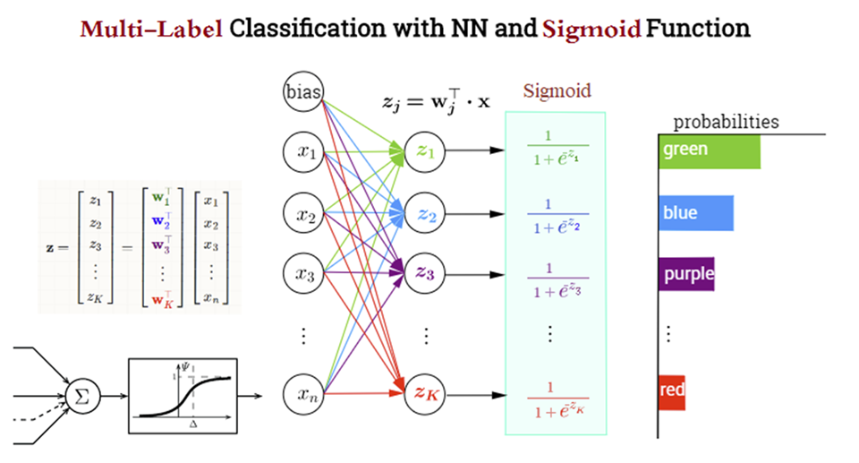{width="75%" fig-align="center"}

## Steps 3-4: Compile and Fit

```{.r}
model |> compile(
  loss = "categorical_crossentropy",
  optimizer = optimizer_rmsprop(),
  metrics = c("accuracy")
)
history <- model |> fit(
  x_train, y_train,
  batch_size = 128,          # feed 128 samples at a time
  epochs = 10,               # traverse the training data 10 times
  validation_split = 0.2     # hold out 20% for validation
)
plot(history)
```

- `compile()` converts the layers to a TensorFlow graph, attaches the loss and optimizer, and arranges metric collection.

## Evaluation and Prediction

:::: {.columns}
::: {.column width="55%"}
```{.r}
model |> evaluate(x_test, y_test)
model |> predict(x_test[1:100, ]) |> apply(1, which.max) - 1
#  [1] 7 2 1 0 4 1 4 9 6 9 0 6 9 0 1 5 9 7 3 4 ...
round(model |> predict(x_test[1:3, ]), 5)
```

Test accuracy is about 98% after 10 epochs.
:::
::: {.column width="45%"}
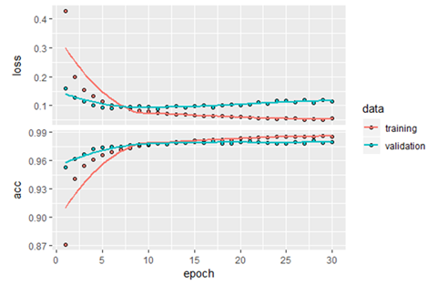{width="90%"}
:::
::::

## An FCN You Can Run Now: `nnet` on Handwritten Digits

Same workflow (train/test split, softmax output, cross-entropy loss, weight decay = $\ell_2$ penalty) on a small simulated 4-class problem, with `nnet`:

```{r}
#| fig-asp: 0.36
set.seed(4750)
centers <- matrix(c(0, 0, 3, 0, 0, 3, 3, 3), ncol = 2, byrow = TRUE)
lab <- sample(1:4, 800, replace = TRUE)
X <- centers[lab, ] + matrix(rnorm(1600, sd = 1.1), ncol = 2)
dat <- data.frame(x1 = X[, 1], x2 = X[, 2], class = factor(lab))
tr <- sample(800, 600)
fit_nn <- nnet(class ~ ., data = dat[tr, ], size = 8, decay = 1e-3, maxit = 500, trace = FALSE)   # softmax output
mean(predict(fit_nn, dat[-tr, ], type = "class") == dat$class[-tr])     # test accuracy
g <- expand.grid(x1 = seq(-3, 6, length = 150), x2 = seq(-3, 6, length = 150))
g$pred <- predict(fit_nn, g, type = "class")
ggplot() + geom_raster(aes(x1, x2, fill = pred), data = g, alpha = .35) +
  geom_point(aes(x1, x2, color = class), data = dat[-tr, ], size = 1.5) + coord_equal() +
  labs(title = "Decision regions of a one-hidden-layer softmax network")
```

## The Keras API: Layers

- 90+ layers (and you can write your own):
  + **Dense:** `layer_dense(units = 64, kernel_regularizer = regularizer_l1(0.01))` (ridge/lasso penalties again!)
  + **Convolutional:** `layer_conv_2d()`, `layer_max_pooling_2d()`
  + **Recurrent:** `layer_simple_rnn()`, `layer_gru()`, `layer_lstm()`
  + **Embedding:** `layer_embedding()`
  + **Regularization:** `layer_dropout()`, `layer_batch_normalization()`

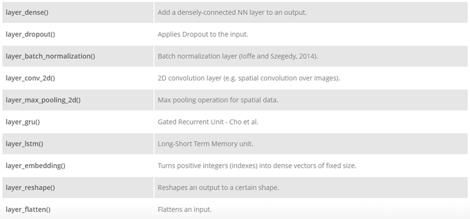{width="45%" fig-align="center"}

# Lecture C: Convolutional Neural Networks {#part-c}

## Why Not Fully Connected Networks for Images?

1. **Too many weights:** a $100\times140\times3$ color image has 42,000 inputs; 100 hidden nodes need 4,200,000 weights in the first layer alone $\Rightarrow$ more data needed, overfitting, slow training.
2. **Flattening destroys spatial structure:** neighboring pixels are correlated in 2-D.

**Convolution** uses small filters shared across the image: few parameters, **local** and **translation-invariant** features.

## Convolution in 1-D

In deep learning "convolution" is really **cross-correlation** (no flip): $(x * w)_i = \sum_k x_{i+k}w_k$.

```{r}
conv1d <- function(x, w) sapply(1:(length(x) - length(w) + 1), function(i) sum(x[i:(i + length(w) - 1)] * w))
x <- c(0, 1, 2, 3, 3); w <- c(2, -1, 1)
conv1d(x, w)
convolve(x, w, type = "filter")                # base R agrees
```

::: notes
- The old slides illustrated the mathematical convolution (with the flip). Keras layers compute cross-correlation; since the filters are learned, the distinction does not matter.
:::

## Convolution in 2-D: Feature Maps

```{r}
#| fig-asp: 0.36
conv2d <- function(img, k, stride = 1, pad = 0) {
  if (pad > 0) { img2 <- matrix(0, nrow(img) + 2 * pad, ncol(img) + 2 * pad)
    img2[(pad + 1):(pad + nrow(img)), (pad + 1):(pad + ncol(img))] <- img; img <- img2 }
  f <- nrow(k); out_r <- (nrow(img) - f) %/% stride + 1; out_c <- (ncol(img) - f) %/% stride + 1
  out <- matrix(0, out_r, out_c)
  for (i in 1:out_r) for (j in 1:out_c) {
    r <- (i - 1) * stride + 1; c <- (j - 1) * stride + 1
    out[i, j] <- sum(img[r:(r + f - 1), c:(c + f - 1)] * k)
  }
  out
}
img <- volcano[seq(1, 87, 2), seq(1, 61, 2)] / max(volcano)
sobel_x <- matrix(c(-1, 0, 1, -2, 0, 2, -1, 0, 1), 3, byrow = TRUE)
fm <- conv2d(img, sobel_x); relu <- pmax(fm, 0)
par(mfrow = c(1, 3), mar = c(1, 1, 2, 1))
image(img, axes = FALSE, main = "input", col = gray.colors(50)); image(fm, axes = FALSE, main = "conv (Sobel x)", col = hcl.colors(50))
image(relu, axes = FALSE, main = "ReLU(conv)", col = hcl.colors(50))
```

## Stride, Padding, and Output Size

$$
\text{Output size} = \frac{N - F + 2P}{S} + 1
$$

```{r}
outsize <- function(N, F, S, P = 0) (N - F + 2 * P) / S + 1
rbind(stride1 = outsize(7, 3, 1), stride2 = outsize(7, 3, 2), stride3 = outsize(7, 3, 3),     # 5, 3, 2.33 (invalid!)
      pad1 = outsize(7, 3, 1, 1))
dim(conv2d(matrix(1:49, 7), matrix(1, 3, 3), stride = 2)); dim(conv2d(matrix(1:49, 7), matrix(1, 3, 3), pad = 1))
```

- Without padding the volume shrinks quickly ($32\to28\to24$ with $5\times5$ filters); **zero padding** keeps the size.
- Common settings: $F = 3, S = 1, P = 1$; $F = 5, S = 1, P = 2$; number of filters $K = 32, 64, 128$.

## Max Pooling

Downsample each feature map: $2\times2$ windows, stride 2, keep the maximum ($100\times100\times128\to50\times50\times128$).

```{r}
maxpool <- function(m, f = 2, s = 2) {
  r <- (nrow(m) - f) %/% s + 1; c <- (ncol(m) - f) %/% s + 1
  outer(1:r, 1:c, Vectorize(function(i, j) max(m[((i - 1) * s + 1):((i - 1) * s + f), ((j - 1) * s + 1):((j - 1) * s + f)])))
}
m <- matrix(c(1, 1, 2, 4, 5, 6, 7, 8, 3, 2, 1, 0, 1, 2, 3, 4), 4, byrow = TRUE)
m; maxpool(m)
```

## CNN Architecture: Review

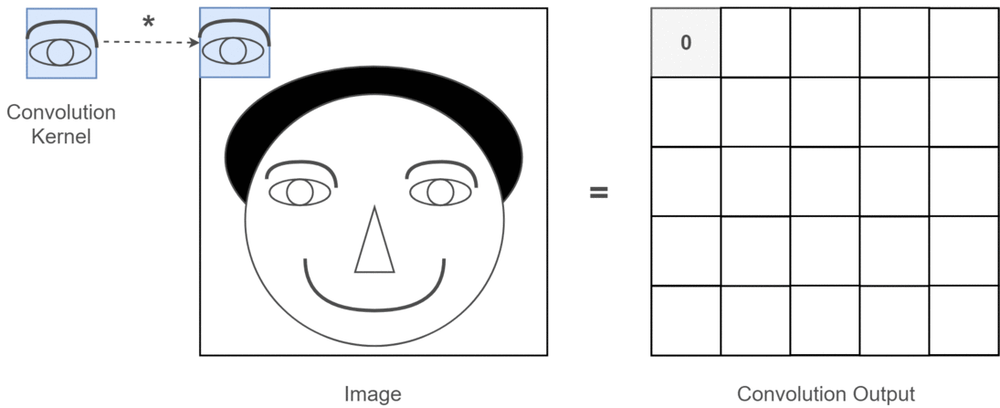{width="40%" fig-align="center"}

- **Input:** raw pixels, e.g. $32\times32\times3$.
- **Conv layer:** $K$ filters $\Rightarrow$ $32\times32\times K$ feature maps (learned features, no hand-designed features).
- **ReLU:** elementwise $\max(0,x)$; size unchanged.
- **Pooling:** spatial downsampling, e.g. $16\times16\times K$.
- **Fully connected + softmax:** class probabilities (e.g. doors 0.1, stairs 0.1, signs 0.8).

## A CNN for MNIST in Keras

```{.r}
x_train <- array_reshape(x_train, c(nrow(x_train), 28, 28, 1)) / 255   # keep the 2-D structure!
cnn <- keras_model_sequential(input_shape = c(28, 28, 1)) |>
  layer_conv_2d(filters = 32, kernel_size = c(3, 3), activation = "relu") |>
  layer_max_pooling_2d(pool_size = c(2, 2)) |>
  layer_conv_2d(filters = 64, kernel_size = c(3, 3), activation = "relu") |>
  layer_max_pooling_2d(pool_size = c(2, 2)) |>
  layer_flatten() |>
  layer_dropout(rate = 0.5) |>
  layer_dense(units = 10, activation = "softmax")
cnn |> compile(loss = "categorical_crossentropy", optimizer = "adam", metrics = "accuracy")
cnn |> fit(x_train, y_train, batch_size = 128, epochs = 15, validation_split = 0.1)
```

```{r}
# parameters: conv1 (3*3*1+1)*32, conv2 (3*3*32+1)*64, dense (5*5*64+1)*10
c(conv1 = (3 * 3 * 1 + 1) * 32, conv2 = (3 * 3 * 32 + 1) * 64, dense = (5 * 5 * 64 + 1) * 10)
```

Far fewer parameters than the 235,146 of the FCN, and about 99% test accuracy. Demo: <https://keras3.posit.co/articles/examples/vision/mnist_convnet.html>.

## Beyond CNNs: Recurrent Networks and Embeddings

:::: {.columns}
::: {.column width="55%"}
```{.r}
rnn <- keras_model_sequential() |>
  layer_lstm(units = 128, input_shape = c(timesteps, features)) |>
  layer_dense(units = 1, activation = "sigmoid")

txt <- keras_model_sequential() |>
  layer_embedding(input_dim = 10000, output_dim = 8) |>
  layer_flatten() |>
  layer_dense(units = 1, activation = "sigmoid")
```

- **RNN/LSTM:** sequences, long-term dependencies (sentiment, forecasting)
- **Embeddings:** dense word vectors learned jointly with the task, or pre-trained (word2vec, GloVe)
:::
::: {.column width="45%"}
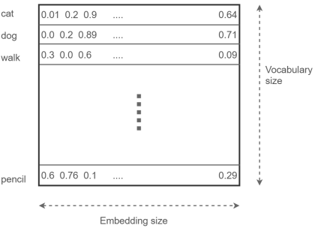{width="95%"}
:::
::::

## Autoencoders: Nonlinear PCA

:::: {.columns}
::: {.column width="55%"}
```{.r}
ae <- keras_model_sequential(input_shape = c(784)) |>
  layer_dense(units = 64, activation = "relu") |>
  layer_dense(units = 32, activation = "relu") |>   # bottleneck
  layer_dense(units = 64, activation = "relu") |>
  layer_dense(units = 784, activation = "sigmoid")
ae |> compile(loss = "mse", optimizer = "adam")
ae |> fit(x_train, x_train, epochs = 20)            # input = target
```

- With **linear** activations and MSE loss, an autoencoder spans the same subspace as **PCA** (deck 08)!
- Applications: dimension reduction, denoising, anomaly detection, inpainting; functional autoencoders for curves.
:::
::: {.column width="45%"}
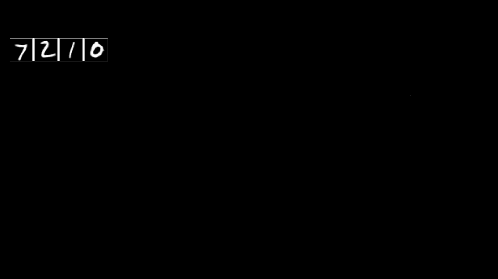{width="95%"}
:::
::::

## Advanced Topics and Deployment

- **Transfer learning:** `application_resnet50()`, fine-tuning pre-trained networks
- Custom layers and callbacks (early stopping: `callback_early_stopping()`)
- Generative models: variational autoencoders, GANs, text generation
- Saving and loading: `save_model(model, "model.keras")`, `load_model()`
- Deployment: Plumber APIs, TensorFlow Serving, **Shiny** (deck 10)

## Python Supplement: The Same FCN in Keras (Python)

```{.python}
import keras
(x_train, y_train), (x_test, y_test) = keras.datasets.mnist.load_data()
x_train = x_train.reshape(-1, 784) / 255
model = keras.Sequential([
    keras.Input(shape=(784,)),
    keras.layers.Dense(256, activation="relu"), keras.layers.Dropout(0.4),
    keras.layers.Dense(128, activation="relu"), keras.layers.Dropout(0.3),
    keras.layers.Dense(10, activation="softmax")])
model.compile(loss="sparse_categorical_crossentropy", optimizer="rmsprop", metrics=["accuracy"])
model.fit(x_train, y_train, batch_size=128, epochs=10, validation_split=0.2)
```

The R `keras3` code is a thin layer over exactly this Python library.

## Summary and Readings

::: instructions
- A network = layers (affine map + nonlinear activation) + loss + optimizer; trained by backpropagation + (stochastic) gradient descent.
- Linear activations collapse to a linear model; depth needs nonlinearity.
- Keras workflow: data tensors $\rightarrow$ `keras_model_sequential()` $\rightarrow$ `compile()` $\rightarrow$ `fit()` $\rightarrow$ `evaluate()`/`predict()`.
- CNNs: shared local filters, stride, padding, pooling; far fewer parameters than FCNs for images.
:::

- F. Chollet, T. Kalinowski, J. J. Allaire, *Deep Learning with R*, 2nd ed., Manning.
- Keras for R: <https://keras3.posit.co/>; cheatsheet: <https://rstudio.github.io/cheatsheets/html/keras.html>
- Stanford CS231n notes: <https://cs231n.github.io/convolutional-networks/>
